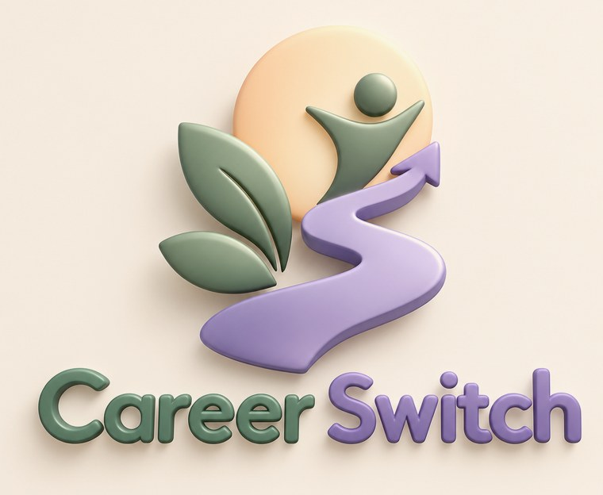
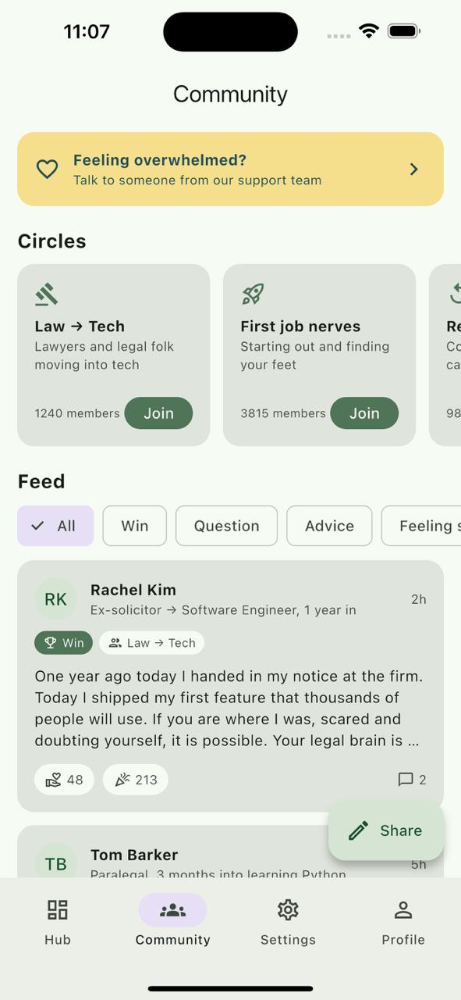
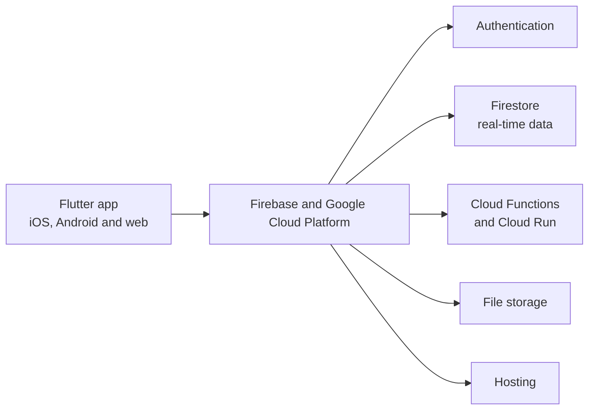

<p align="center">
  
</p>

<h3 align="center">A supportive, compassionate, community-based app for people taking their first steps towards a new career.</h3>

<p align="center">
  
  
  
  
</p>

---

## The challenge

Built for **Challenge 2 of the HuddleHive Women in Tech Hackathon**, sponsored by Starling:

> *Build something that helps someone become who they could be.*

We took the **Pass It On** path: build something that helps someone else take their first step. For us, that step is changing career.

## The problem

Changing career should not feel impossible, but for many people it does.

- **Graduates are struggling to find work.** 6.2% of UK graduates from the 2022/23 cohort were unemployed, up from 5.0% for the 2020/21 cohort. *(Source: Jisc, "The graduate labour market in Spring 2026", using Graduate Outcomes survey data.)*
- **Young people are being locked out.** 16.4% of 16 to 24-year-olds in the UK were unemployed in May to July 2026. *(Source: House of Commons Library, "Youth unemployment statistics", 15 September 2026, based on ONS data.)*
- **Professionals feel stuck** in jobs that make them unhappy.
- **Traditional upskilling is overwhelming.** Multi-year degrees and dense video courses are long, expensive and exhausting.

## Our solution

**CareerSwitch turns a career change into bite-sized, gamified daily actions.**

Plenty of apps offer lessons. CareerSwitch is built on three pillars that set it apart:

| Pillar | What it means |
| --- | --- |
| **Community** | Learn alongside people making the same move. |
| **Support** | Guidance and encouragement at every step of the path. |
| **Compassion** | Progress at your own pace, without guilt or burnout. |

### Meet Alex Morgan

Alex is a corporate lawyer who wants to become a software engineer. A degree would take years and feel discouraging. With CareerSwitch, steady daily progress makes the move achievable in manageable steps, with a target of two years.

## Features

<p align="center">
  
</p>

- **Stage tracker:** shows where you are on your journey, such as *Exploration stage, 4 of 8*.
- **Learning hub:** tiles for Events, Mentors and Experts, Skills and Learning, Explore, Project Room and Support.
- **Community circles:** join groups of people on the same path, such as *Law to Tech* or *First job nerves*.
- **Community feed:** wins, questions and advice from people a step or two ahead, with filters and a Share button.
- **Support, one tap away:** a "Feeling overwhelmed?" banner connects users to the support team.
- **Navigation:** Hub, Community, Settings and Profile.

## Tech stack

### What is built today

The prototype is a **frontend only**, written in **Flutter and Dart** and run on an emulator, using **predefined data**. We built it this way because of the hackathon's time constraints, and it still shows what CareerSwitch embodies: a supportive, compassionate, community-based app.

### Long-term vision

A full-stack solution with a single cross-platform codebase.



| Layer | Technology |
| --- | --- |
| Frontend | Flutter (iOS, Android and web from one codebase) |
| Authentication | Firebase Authentication |
| Database | Cloud Firestore (real-time data) |
| Business logic | Cloud Functions and Cloud Run (serverless) |
| Storage and hosting | Firebase Storage and Firebase Hosting |

## Getting started

**Prerequisites:** the [Flutter SDK](https://docs.flutter.dev/get-started/install) and an iOS simulator, Android emulator or Chrome.

```bash
# 1. Clone the repository
git clone https://github.com/AmalAbdirahman/careerswitch.git
cd careerswitch

# 2. Install dependencies
flutter pub get

# 3. Run the app
flutter run
```

The app uses predefined data, so no API keys or backend setup are needed.

## Pitch deck

Our presentation is in [`docs/`](docs/). Open `docs/index.html` in a browser and use the arrow keys to move between slides. *(If GitHub Pages is enabled, it is also available at: [link].)*

## Business model

CareerSwitch has two revenue streams: memberships that fund us from launch, and partnerships that scale us long term.

1. **Pathfinder Plus (£9.99 a month).** A free core community drives growth. Members who want more personal support upgrade for priority access to leading experts in their target industry, members-only events and sessions, curated learning pathways, in-person CV and interview 1-to-1s, and personalised recommendations. *Target conversion: 5% of active users.*
2. **Partnerships (around £15,000 per partner per year).** Universities, job centres and government employment programmes license CareerSwitch to support their students and job seekers. One partnership onboards users in bulk, which lowers acquisition costs and supports our goal of reducing job anxiety and unemployment.

## Roadmap

- [x] Frontend prototype in Flutter with predefined data
- [ ] Connect the backend: Firebase and Google Cloud Platform
- [ ] Pilot with a first partner
- [ ] AI chatbot for deeper, real-time guidance
- [ ] Machine learning insights to improve learning paths
- [ ] Expand to college sixth form leavers and young adults looking for apprenticeships
- [ ] Partnerships with course providers such as LinkedIn Learning and Coursera

## Challenges

- **Time constraints:** we focused on the frontend so we could show the full user experience.
- **Predefined data:** without a live backend, accounts, real-time community posts and saved progress are not working yet.

## The team

| Name | GitHub | LinkedIn |
| --- | --- | --- |
| Amal | [@username](https://github.com/AmalAbdirahman) | [Profile](https://www.linkedin.com/) |
| Mariyah | [@username](https://github.com/) | [Profile](https://www.linkedin.com/) |
| Toobah | [@username](https://github.com/tooba543) | [Profile](https://www.linkedin.com/) |

## Acknowledgements

Thank you to **HuddleHive** and the **Engine by Starling** team for hosting and sponsoring the hackathon, and to the organisers and mentors for their feedback and support.

## Licence

[Add a licence, for example MIT, or remove this section.]

<p align="center"><em>Small steps every day, one new career. 🌱</em></p>
